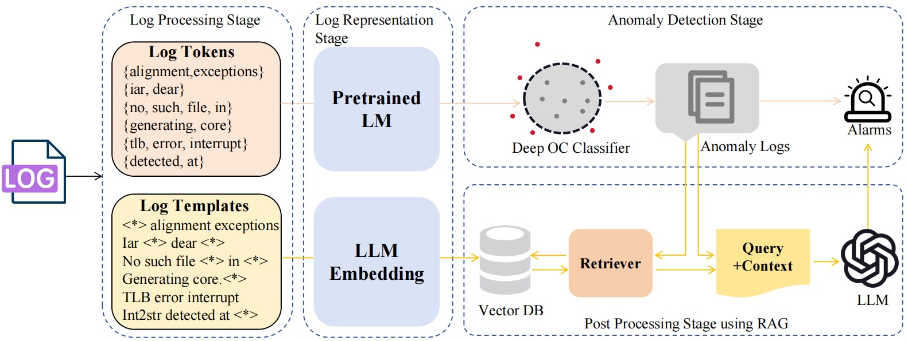

# Leveraging RAG-Enhanced Large Language Model for Semi-Supervised Log Anomaly Detection (ISSRE-2024)
[](https://doi.org/10.5281/zenodo.13372812)



This is the basic implementation of our submission in ISSRE 2024: Leveraging RAG-Enhanced Large Language Model for Semi-Supervised Log Anomaly Detection 

## Description

Log-based anomaly detection is critical in monitoring the operations of information systems and in the realtime reporting of system failures. Utilizing deep learning-based  log anomaly detection methods facilitates effective detection of  anomalies within logs. However, existing methods are greatly  dependent on log parsers, and parsing errors can considerably  affect downstream anomaly detection tasks. Additionally, methods that predict the next log event in a sequence are susceptible  to the instability of sequences and the emergence of unseen logs  as systems evolve, resulting in a higher false positive rate. In this  paper, we put forward LogRAG, a semi-supervised log anomaly  detection framework based on retrieval-augmented generation  (RAG). This framework conducts phased detection using both  Log Tokens and Log Templates to mitigate the impact of log  parsing errors. It also utilizes a single-class classifier to model the  normal behavior of the system, thereby circumventing the effects  of unstable sequences. Finally, it employs large language model  (LLM) empowered by RAG to reevaluate detected anomalous  logs, thereby improving accuracy. LogRAG demonstrates a 15%  improvement in F1 Score on the BGL dataset and a 60%  improvement on the Spirit dataset when compared to the previous  best semi-supervised learning algorithm.

## **Project Structure**

```jsx
LogRAG
├── .gitignore
├── README.md
├── config.yaml # config file
├── dataset  # train and test file
├── main.py # mian method
├── postprocess # post processing stage using RAG 
├── prelogad # anomaly detection stage
├── pretrained # pretrained language model
├── output # results
├── requirements.txt
└── utils
```

## Dataset

We will use the BGL and Spirit datasets for our experiments, which you can find in [LogHub]( https://github.com/logpai/loghub) or [LogADEmpirical](https://github.com/LogIntelligence/LogADEmpirical/tree/dev)


| **Dataset**  | **Size** | **# Logs** | **# Anomalies** | **Anomaly Ratio** |
|:-------------|:---------|:-----------|:----------------|:------------------|
| BGL          | 743 MB   | 4,747,963  | 348,460         | 7.34 %            |
| Spirit       | 1.4 GB   | 5,000,000  | 764,500         | 15.29%            |


The raw logs need to be parsed to get a structured log. Here, we use BGL.log_structured.csv and Spirit.log_structured.csv as the [Drain](https://github.com/logpai/logparser/tree/main/logparser/Drain) parsed data

## Reproducibility Instructions

### Environment Setup

**Requirements:**

- Python 3.8.18
- NVIDIA GPU + CUDA cuDNN
- PyTorch 1.13.0
- langchain 0.2.14
- transformers 4.37.2
- openai 1.42.0

The required packages are listed in requirements.txt. Install:

`pip install -r requirements.txt`

### Getting Started

You need to follow these steps to **completely** run `LogRAG` (Let's take an example of using LogRAG on the BGL-Example dataset)

**Step1: prepare the pretrained language model**

1. Get the BigLog model files from the
   [BigLog pretrained-model repository](https://github.com/BiglogOpenSource/PretrainedModel).
   The checked-in `pytorch_model.bin` is a placeholder; download the actual
   checkpoint from [Google Drive](https://drive.google.com/file/d/12phqzt2QiAHjaO-BUDSyzNcmdg835rJG/view?usp=sharing)
   and place it in `./pretrained`. The Kaggle notebook performs these download
   steps automatically.
2. The default local chat backend uses Ollama and a GGUF conversion of
   [Mistral-7B-Instruct-v0.1](https://huggingface.co/TheBloke/Mistral-7B-Instruct-v0.1-GGUF).
   The original `mistralai/Mistral-7B-Instruct-v0.1` repository contains
   Safetensors; Ollama needs GGUF weights.
3. The default Hugging Face embedding model is
   `sentence-transformers/all-MiniLM-L6-v2`. An OpenAI chat or embedding backend
   remains available when its API key is supplied at runtime; do not commit
   credentials.
4. For a local run outside Kaggle, install Ollama, start `ollama serve`, and
   pull `hf.co/TheBloke/Mistral-7B-Instruct-v0.1-GGUF:Q4_K_M` before running
   `main.py`.

**Step2: set config parameters**

```jsx
is_train: True # train deepsvdd
is_rag: True # use post processing stage
dataset_name: BGL
train_ratio: 0.8
window_size: 200 
window_time: 1800 # 30 minutes

# dataset and model paths
log_structed_path: ./dataset/BGL/bgl-example.log_structured.csv
encoder_path: ./pretrained

# OpenAI credentials are only needed if an OpenAI backend is selected.
api_key: ""
api_base: https://api.openai.com/v1

llm_backend: ollama
llm_name: hf.co/TheBloke/Mistral-7B-Instruct-v0.1-GGUF:Q4_K_M
ollama_base_url: http://127.0.0.1:11434
embedding_backend: huggingface
embedding_model: sentence-transformers/all-MiniLM-L6-v2
embedding_device: cpu

# deepsvdd parameters
normal_class: 0
is_pretrain: False
optimizer_name: adam
lr: 0.0001
n_epochs: 150
lr_milestones: [50]
batch_size: 40960
weight_decay: 0.0005
device: cuda:0
n_jobs_dataloader: 0

# rag parameters
threshold: 0.8
topk: 5
prompt: prompt5
persist_directory: ./output/ragdb-bgl

```

You can adjust configs parameters to verify the effect of LogRAG under different experimental conditions. The main fields are explained as follows:

- **is_train:** Whether to train the DeepOC module, this should be set to True for the first run or when switching conditions
- **is_rag:** Whether the RAG post-processing module is enabled or not, if False, the experimental results are only the results detected by DeepOC
- **window_size:** This fixes the window size
- **window_time:** This is a fixed amount of time in seconds

**Step3: let’s go !**

Download the dataset and the desired model, and then adjust the configs parameters to what you want, then:

`python main.py` 

and you will find the results in outpout/runtime.log ！

## Kaggle shared-protocol BGL run

The legacy `python main.py` path uses an 80/20 record split and is not the
shared thesis benchmark. Use `main_shared.py` for BGL protocol-v1 evaluation.
It aligns each parsed record to the common non-overlapping 200-record windows,
validates their labels, trains on the train windows, reports validation metrics,
and evaluates the held-out test windows once.

Attach these as Kaggle input datasets:

- The parsed `bgl_structured.jsonl` file from the `dataset-structured` dataset.
- The `benchmark_protocol_v1` dataset containing `bgl.csv` and
  `manifest.json`.

The Kaggle notebook discovers these files under `/kaggle/input` and converts
the BGL JSONL to the required `LineId`, `Label`, `Timestamp`, `Content`, and
`EventTemplate` CSV in streaming mode. It checks the source record count
against the shared protocol before continuing.

The notebook clones the BigLog model repository and downloads the real
`pytorch_model.bin` checkpoint into `/kaggle/working/BigLog/pretrained`; do not
attach the BigLog checkpoint as an input dataset. This requires Kaggle Internet
access to GitHub and Google Drive.

Install the Kaggle-specific requirements without replacing Kaggle's
CUDA-enabled PyTorch:

```bash
pip install -r requirements-kaggle.txt
```

Enable Internet and a GPU accelerator in Kaggle. The notebook installs `zstd`
if missing, installs and starts Ollama, then pulls
`hf.co/TheBloke/Mistral-7B-Instruct-v0.1-GGUF:Q4_K_M` from Hugging Face. It
uses `sentence-transformers/all-MiniLM-L6-v2` for local embeddings, so this
configuration does not require an API key. This embedding choice changes the
retrieval component from the previous OpenAI embedding setup and should be
reported as such in thesis results. The 4-bit Mistral download and inference
consume Kaggle storage/GPU runtime.

The Ollama request uses prompt-based JSON output instead of constrained
`format: "json"` because the Kaggle Ollama runtime returned a sampler
initialization error for that mode; the pipeline still parses and repairs
non-JSON model output.

If switching to OpenAI, supply the key as a Kaggle Secret; never put
credentials in this repository. Then set:

```text
LOGRAG_STRUCTURED_CSV=/kaggle/input/<dataset>/BGL.log_structured.csv
LOGRAG_ENCODER_PATH=/kaggle/working/BigLog/pretrained
LOGRAG_PROTOCOL_DIR=/kaggle/input/<dataset>/benchmark_protocol_v1
LOGRAG_SHARED_OUTPUT_DIR=/kaggle/working/lograg-results
LOGRAG_OUTPUT_DIR=/kaggle/working/lograg-results
LOGRAG_PERSIST_DIRECTORY=/kaggle/working/lograg-results/ragdb-bgl
```

From the `LogRAG` directory, run:

```bash
python main_shared.py
```

The output includes `results.json` and one window-level prediction CSV for
validation and test, plus `model_activity.json` with the chat/embedding
backends and query counts. This Ollama run uses local inference, not provider
API billing. The current shared runner covers BGL only; HDFS requires the
separate block-level adaptation and must not be reported as a completed
LogRAG benchmark yet.
