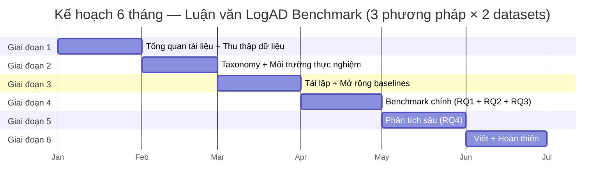

# KẾ HOẠCH THỰC HIỆN LUẬN VĂN THẠC SĨ (CHI TIẾT 6 THÁNG)

> **📌 Lưu ý quan trọng:**  
> - File này là **overview** cho con người đọc và theo dõi tiến độ tổng thể  
> - Để agents/AI assistants thực hiện: xem [`ke_hoach_agent_executable.md`](./ke_hoach_agent_executable.md)  
> - File agent-executable có: input/output rõ ràng, code mẫu, acceptance criteria, verification steps

---

## TỔNG QUAN

**Kế hoạch chi tiết thực hiện đề cương:**
- 3 phương pháp đại diện (LightAD, LogFormer, LogRAG)
- 2 datasets chuẩn (HDFS_v3, BGL)
- 4 Research Questions (RQ1-RQ4)
- 6 tháng thực hiện (01/2027 - 06/2027)

---

## GIAI ĐOẠN 1: TỔNG QUAN TÀI LIỆU VÀ THU THẬP DỮ LIỆU (Tháng 1)

_Tương ứng với T1 trong đề cương: ND1 — Dữ liệu log và phân tích log_

### Tuần 1-2: Nghiên cứu tài liệu chuyên sâu

| # | Task | Output |
|---|---|---|
| 1.1 | Đọc kỹ 3 bài báo gốc (LightAD, LogFormer, LogRAG) | Bảng tóm tắt cho mỗi bài: kiến trúc, data, metric, kết quả, hạn chế |
| 1.2 | Đọc ≥30 bài báo liên quan (DeepLog, LogAnomaly, LogRobust, LogBERT, CoLog, Logs2Graph, SemPCA, PLELog, etc.) | Bảng tổng hợp ≥30 bài báo |
| 1.3 | Nghiên cứu về bản chất dữ liệu log: semi-structured, non-stationary, high-velocity | Tổng hợp đặc điểm dữ liệu log |
| 1.4 | Nghiên cứu ACM SIGSOFT Empirical Standards | Checklist cho thiết kế thực nghiệm |

### Tuần 3: Thu thập dữ liệu và xây dựng pipeline

| # | Task | Output |
|---|---|---|
| 1.5 | Tải datasets từ LogHub: HDFS_v3 (14.8M dòng), BGL (4.7M dòng) | Raw data files |
| 1.6 | Xây dựng pipeline log parsing bằng Drain | Drain parser hoàn chỉnh |
| 1.7 | Phân tích thống kê mô tả: số lượng sự kiện, tỷ lệ bất thường, phân phối template | Bảng phân tích đặc điểm 2 datasets |
| 1.8 | So sánh đặc điểm HDFS_v3 (fault injection, block-based) vs. BGL (natural errors, time-based) | Comparative analysis |

### Tuần 4: Xác định RQ và viết Chương 1-2 (nháp)

| # | Task | Output |
|---|---|---|
| 1.9 | Hoàn thiện 4 RQ: RQ1 (hiệu quả), RQ2 (chi phí), RQ3 (trade-off), RQ4 (phân tích lỗi) | RQ document được duyệt |
| 1.10 | Viết bản nháp Chương 1 (Giới thiệu) | ~15-20 trang |
| 1.11 | Viết bản nháp Chương 2 (Cơ sở lý thuyết — Phần dữ liệu log) | ~10-12 trang |
| 1.12 | Trình người hướng dẫn duyệt RQ + pipeline | Feedback → điều chỉnh |

> **Deliverable (T1):** Bảng tổng hợp ≥30 bài báo; Bảng phân tích đặc điểm 2 dataset; Pipeline tiền xử lý log hoàn chỉnh; Bản nháp Chương 1–2

---

## GIAI ĐOẠN 2: HỆ THỐNG HÓA PHÁT HIỆN BẤT THƯỜNG VÀ THIẾT LẬP MÔI TRƯỜNG (Tháng 2)

_Tương ứng với T2 trong đề cương: ND2 — Phát hiện bất thường trên dữ liệu log_

### Tuần 1-2: Hệ thống hóa khung khái niệm

| # | Task | Output |
|---|---|---|
| 2.1 | Định nghĩa chính xác "bất thường" (anomaly vs. fault vs. failure) | Khung định nghĩa |
| 2.2 | Phân loại 3 dạng bất thường: point, collective, contextual | Bảng phân loại |
| 2.3 | Hệ thống hóa các hướng tiếp cận: supervised, semi-supervised, unsupervised | Taxonomy approaches |
| 2.4 | Xây dựng taxonomy các họ kỹ thuật: ML cổ điển, Deep Learning, LLM-RAG | Bảng taxonomy anomaly detection |
| 2.5 | Viết phần Chương 2 (tiếp) — Phát hiện bất thường | ~10-12 trang |

### Tuần 3: Cài đặt môi trường thực nghiệm

| # | Task | Output |
|---|---|---|
| 2.6 | Tạo virtual environment chung (Python 3.8+) | env config |
| 2.7 | Cài đặt dependencies: PyTorch 1.13+, transformers 4.x, scikit-learn latest | `requirements.txt` |
| 2.8 | Thiết lập GPU environment (NVIDIA RTX 3090, CUDA, cuDNN) | GPU ready |
| 2.9 | Tải pretrained models: BigLog (LogRAG) | Pretrained files |
| 2.10 | Test môi trường với dummy runs | Verification report |

### Tuần 4: Viết Chương 3 (bản nháp)

| # | Task | Output |
|---|---|---|
| 2.11 | Viết Chương 3 (Phương pháp nghiên cứu): pipeline, giao thức thực nghiệm, RQ | ~15-20 trang |
| 2.12 | Mô tả chi tiết quy trình thực nghiệm end-to-end (5 bước) | Methodology document |
| 2.13 | Mô tả kiểm soát công bằng: phần cứng, seed, hyperparameters | Experimental protocol |
| 2.14 | Trình người hướng dẫn duyệt Chương 2 (hoàn chỉnh) + Chương 3 (nháp) | Feedback → điều chỉnh |

> **Deliverable (T2):** Bảng taxonomy anomaly detection; Khung khái niệm hoàn chỉnh; Môi trường thực nghiệm sẵn sàng; Bản nháp Chương 3

---

## GIAI ĐOẠN 3: TÁI LẬP BASELINES VÀ MỞ RỘNG PIPELINE (Tháng 3)

_Tương ứng với T3 trong đề cương: ND3 (a) — Tái lập và mở rộng_

### Tuần 1: Tái lập baseline 1-2

| # | Task | Output | Rủi ro |
|---|---|---|---|
| 3.1 | **LightAD:** Fix hardcoded paths; chạy `preprocess.py --dataset hdfs` → `main_hdfs.py --model knn/dt/slfn`; tương tự cho BGL | Kết quả trên HDFS_v3, BGL | Thấp — code đơn giản |
| 3.2 | **LogFormer:** Drain parsing → `train_transformer.py` → `tune_transformer.py` cho HDFS_v3, BGL | Pre-train + adapter tune results | Trung bình — cần GPU |
| 3.3 | Xây dựng data splitting scripts thống nhất (80/10/10) | `split_data.py` |

### Tuần 2: Tái lập baseline 3

| # | Task | Output | Rủi ro |
|---|---|---|---|
| 3.4 | **LogRAG:** Set API key hoặc setup Mistral-7B local; `config.yaml` → `python main.py` cho BGL | DeepSVDD + RAG results trên BGL | Cao — API/GPU |
| 3.5 | Kiểm tra kết quả tái lập LogRAG trên BGL với bài báo gốc | Reproduction report |  |
| 3.6 | Xây dựng evaluation scripts thống nhất (P/R/F1/PR-AUC/FPR) | `evaluate.py` |

> [!WARNING]
> **Dự phòng:** Nếu LogRAG không thể tái lập sau 1.5 tuần, giảm xuống 2 phương pháp và báo cáo lý do.

### Tuần 3: Mở rộng LogRAG cho HDFS_v3

| # | Task | Chi tiết kỹ thuật | Output |
|---|---|---|---|
| 3.7 | **LogRAG → HDFS_v3** | Tạo `log_structured.csv` format; điều chỉnh window strategy theo trace ID | LogRAG chạy trên HDFS_v3 |
| 3.8 | Validation kết quả | Kiểm tra output hợp lý; debug nếu cần | Validation report |

### Tuần 4: Validation chạy sơ bộ

| # | Task | Output |
|---|---|---|
| 3.9 | Chạy **tất cả 3 phương pháp** trên **tất cả 2 datasets** | 3×2 = 6 kết quả sơ bộ |
| 3.10 | Kiểm tra sanity: kết quả có hợp lý? Có bug? | Bug report + fixes |
| 3.11 | Đối chiếu kết quả với bài báo gốc | Comparison report |
| 3.12 | Document tất cả code changes | Technical documentation |

> **Deliverable (T3):** 3 baselines tái lập thành công; 6 cấu hình chạy thông suốt; Reproduction Report

---

## GIAI ĐOẠN 4: CHẠY BENCHMARK CHÍNH (RQ1 + RQ2 + RQ3) (Tháng 4)

_Tương ứng với T4 trong đề cương: ND3 (b) — Benchmark hiệu quả và chi phí_

### Tuần 1-2: RQ1 — Hiệu quả phát hiện

| # | Task | Output |
|---|---|---|
| 4.1 | Chạy chính thức 3 phương pháp × 2 datasets × nhiều lần (seed cố định) | Raw results |
| 4.2 | Tính **Precision, Recall, F1-score, PR-AUC, FPR** cho mỗi run | Metrics tables |
| 4.3 | Tính trung bình ± std | Summary tables |
| 4.4 | Tạo bảng benchmark chéo (3 × 2 × metrics) | **Bảng RQ1 chính** |

### Tuần 3: RQ2 — Chi phí tính toán

| # | Task | Output |
|---|---|---|
| 4.5 | Đo **thời gian huấn luyện** (wall-clock time trên cùng GPU) | Training time table |
| 4.6 | Đo **độ trễ suy luận** (latency/sample, ms) | Inference latency table |
| 4.7 | Đo **throughput** (samples/second) | Throughput table |
| 4.8 | Đo **bộ nhớ đỉnh** GPU (VRAM) + RAM (nvidia-smi / memory_profiler) | Memory table |
| 4.9 | Ước tính **chi phí API LLM** cho LogRAG (nếu dùng API) | Cost analysis (USD) |

### Tuần 4: RQ3 — Đánh đổi hiệu năng-chi phí + visualizations

| # | Task | Output |
|---|---|---|
| 4.10 | Phân tích **Pareto trade-off** giữa ML cổ điển, Transformer, LLM-RAG | Analysis report |
| 4.11 | Tạo biểu đồ **F1 vs. Latency** (scatter plot) | Figure |
| 4.12 | Tạo biểu đồ **F1 vs. Memory** (scatter plot) | Figure |
| 4.13 | Tạo radar chart / bar chart so sánh 3 phương pháp | Figure |
| 4.14 | Phân tích sơ bộ kết quả RQ1-RQ3 | Analysis draft |

> **Deliverable (T4):** Bảng số liệu benchmark RQ1–RQ2; Biểu đồ Pareto trade-off RQ3; Báo cáo thực nghiệm chi tiết

---

## GIAI ĐOẠN 5: PHÂN TÍCH SÂU (RQ4) (Tháng 5)

_Tương ứng với T5 trong đề cương: ND3 (c) — Phân tích lỗi và khả năng giải thích_

### Tuần 1-2: RQ4 (a) — Phân tích lỗi có cấu trúc

| # | Task | Output |
|---|---|---|
| 5.1 | Trích xuất 50-100 FP + 50-100 FN từ mỗi phương pháp × dataset | FP/FN samples (3×2 = 6 sets) |
| 5.2 | Phân loại thủ công theo taxonomy: unseen template, chuỗi ngắn, nhiễu, class imbalance, parsing errors | Error classification |
| 5.3 | Tổng hợp tỷ lệ từng nhóm lỗi | Error distribution table |
| 5.4 | Viết case study minh họa (2-3 ví dụ cụ thể cho mỗi phương pháp) | Case studies |

### Tuần 3: RQ4 (b) — Khả năng giải thích

| # | Task | Output |
|---|---|---|
| 5.5 | **LightAD:** Thu thập feature importance (SLFN/DT), nearest neighbor analysis (KNN) | Explainability examples |
| 5.6 | **LogFormer:** Visualization attention weights | Attention maps |
| 5.7 | **LogRAG:** Thu thập LLM reasoning output | LLM reasoning examples |
| 5.8 | So sánh chất lượng giải thích: **actionability, clarity, correctness** | Explainability comparison |
| 5.9 | Đánh giá mức độ hỗ trợ kỹ sư vận hành từ các cơ chế giải thích | Support analysis |

### Tuần 4: Kiểm tra độ tin cậy + viết Chương 4-5

| # | Task | Output |
|---|---|---|
| 5.10 | Kiểm tra statistical significance (Wilcoxon / paired t-test nếu applicable) | Statistical tests |
| 5.11 | Xây dựng cẩm nang khuyến nghị triển khai (cây quyết định) | Decision tree / Guidelines |
| 5.12 | Viết Chương 4 (Kết quả thực nghiệm) bản nháp | ~15-20 trang |
| 5.13 | Viết Chương 5 (Thảo luận) bản nháp | ~10-15 trang |
| 5.14 | Trình người hướng dẫn duyệt Chương 4-5 | Feedback → điều chỉnh |

> **Deliverable (T5):** Kết quả phân tích RQ4; Case study mẫu lỗi; Cây quyết định khuyến nghị; Bản nháp Chương 4–5

---

## GIAI ĐOẠN 6: VIẾT VÀ HOÀN THIỆN (Tháng 6)

_Tương ứng với T6 trong đề cương: Hoàn thiện toàn văn luận văn_

### Tuần 1-2: Viết và hoàn thiện các chương

| # | Task | Output |
|---|---|---|
| 6.1 | Hoàn thiện Chương 1: Giới thiệu (dựa trên kết quả thực tế) | Final Chapter 1 |
| 6.2 | Hoàn thiện Chương 2: Cơ sở lý thuyết | Final Chapter 2 |
| 6.3 | Hoàn thiện Chương 3: Phương pháp nghiên cứu | Final Chapter 3 |
| 6.4 | Hoàn thiện Chương 4: Kết quả thực nghiệm | Final Chapter 4 |
| 6.5 | Hoàn thiện Chương 5: Thảo luận | Final Chapter 5 |
| 6.6 | Viết Chương 6: Kết luận và Hướng phát triển | Final Chapter 6 |

### Tuần 3: Rà soát và đóng gói

| # | Task | Output |
|---|---|---|
| 6.7 | Rà soát toàn bộ luận văn: logic, nhất quán, chính tả | Revised draft |
| 6.8 | Hoàn thiện tất cả hình vẽ, bảng biểu, phụ lục | Final figures/tables/appendices |
| 6.9 | Viết tài liệu tham khảo (bibliography) đầy đủ | Bibliography |
| 6.10 | Đóng gói mã nguồn thực nghiệm và tài liệu hướng dẫn tái lập | Reproducibility package |
| 6.11 | Chuẩn bị repository công khai: code + data + scripts + documentation | Public repository |
| 6.12 | Gửi cho người hướng dẫn review | Feedback → revisions |

### Tuần 4: Chuẩn bị bảo vệ

| # | Task | Output |
|---|---|---|
| 6.13 | Sửa theo feedback người hướng dẫn | Final thesis |
| 6.14 | Tạo slide bảo vệ (30-40 slides) | Presentation |
| 6.15 | Luyện trình bày (15-20 phút) | Practice |
| 6.16 | Chuẩn bị câu hỏi phản biện dự kiến | Q&A preparation |

> **Deliverable (T6):** Luận văn hoàn chỉnh; Repository mã nguồn mở; Slide và báo cáo bảo vệ

---

## TỔNG HỢP RISKS & MITIGATIONS

| Risk | Likelihood | Impact | Mitigation |
|---|---|---|---|
| LogRAG API key không khả dụng / chi phí cao | Cao | Cao | Dùng Mistral-7B local thay GPT; hoặc giảm xuống 2 phương pháp (LightAD + LogFormer) |
| GPU không đủ cho LogFormer training | Thấp | Trung bình | Dùng Google Colab Pro hoặc cloud GPU; giảm batch_size |
| Kết quả tái lập khác xa bài báo gốc | Trung bình | Trung bình | Ghi nhận sai khác; liên hệ tác giả gốc; kiểm tra hyperparameters |
| Dataset HDFS_v3 quá lớn (14.8M dòng) | Thấp | Thấp | Sampling có kiểm soát nếu cần; báo cáo rõ |
| Thời gian viết không đủ | Thấp | Trung bình | Viết song song với thực nghiệm (nháp Chương 1-3 sớm) |
| Taxonomy phát hiện bất thường thiếu depth | Trung bình | Thấp | Tham khảo survey papers (Chalapathy & Chawla, ACM Computing Surveys 2019) |

---

## CHECKLIST TỔNG THỂ

Theo đề cương T1-T6:

- [ ] **Tháng 1 (T1):** Bảng tổng hợp ≥30 bài báo; Bảng phân tích đặc điểm 2 datasets; Pipeline tiền xử lý log hoàn chỉnh; Bản nháp Chương 1-2
- [ ] **Tháng 2 (T2):** Bảng taxonomy anomaly detection; Khung khái niệm hoàn chỉnh; Môi trường thực nghiệm sẵn sàng; Bản nháp Chương 3
- [ ] **Tháng 3 (T3):** 3 baselines tái lập thành công; 6 cấu hình chạy thông suốt; Reproduction Report
- [ ] **Tháng 4 (T4):** Bảng số liệu benchmark RQ1–RQ2; Biểu đồ Pareto trade-off RQ3; Báo cáo thực nghiệm chi tiết
- [ ] **Tháng 5 (T5):** Kết quả phân tích RQ4; Case study mẫu lỗi; Cây quyết định khuyến nghị; Bản nháp Chương 4-5
- [ ] **Tháng 6 (T6):** Luận văn hoàn chỉnh; Repository mã nguồn mở; Slide và báo cáo bảo vệ

---

## MAPPING VỚI ĐỀ CƯƠNG

| Tháng | Nội dung đề cương | Giai đoạn chi tiết | Deliverable chính |
|:---:|---|---|---|
| **T1** | **ND1:** Dữ liệu log và phân tích log | Giai đoạn 1 (4 tuần) | Bảng ≥30 bài báo; Pipeline; Chương 1-2 nháp |
| **T2** | **ND2:** Phát hiện bất thường + Môi trường | Giai đoạn 2 (4 tuần) | Taxonomy; Môi trường; Chương 3 nháp |
| **T3** | **ND3 (a):** Tái lập baselines + Mở rộng | Giai đoạn 3 (4 tuần) | 3×2 cấu hình; Reproduction Report |
| **T4** | **ND3 (b):** Benchmark RQ1, RQ2, RQ3 | Giai đoạn 4 (4 tuần) | Bảng benchmark; Biểu đồ trade-off |
| **T5** | **ND3 (c):** Phân tích lỗi RQ4 | Giai đoạn 5 (4 tuần) | Phân tích FP/FN; Explainability; Chương 4-5 |
| **T6** | Hoàn thiện toàn văn | Giai đoạn 6 (4 tuần) | Luận văn; Repository; Slide bảo vệ |

**Research Questions (theo đề cương):**
- **RQ1:** Hiệu quả phát hiện (Precision, Recall, F1-score, PR-AUC, FPR)
- **RQ2:** Chi phí tính toán (thời gian huấn luyện, độ trễ suy luận, bộ nhớ đỉnh)
- **RQ3:** Đánh đổi hiệu năng-chi phí (Pareto trade-off: F1 vs. Latency, F1 vs. Memory)
- **RQ4:** Phân tích lỗi và khả năng giải thích (FP/FN taxonomy, explainability comparison)
